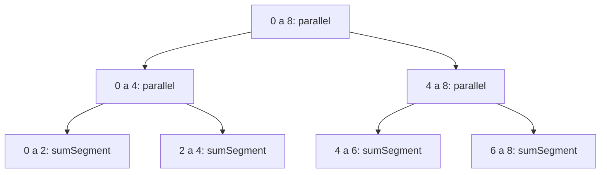

# Suma de potencias sobre un arreglo, repartida con `parallel`

## El cálculo

`sumSegment` recorre un tramo del arreglo y acumula la potencia `p` de cada
elemento. Es una recursión de cola con acumulador.

```Scala
def power(x: Int, p: Double): Double =
  math.pow(math.abs(x.toDouble), p)

def sumSegment(a: Array[Int], p: Double, s: Int, t: Int): Double = {
  def aux(i: Int, acc: Double): Double =
    if (i >= t) acc
    else aux(i + 1, acc + power(a(i), p))
  aux(s, 0.0)
}
```

En notación matemática, con el tramo entre `s` incluido y `t` excluido:

```math
\text{sumSegment}(a, p, s, t) = \sum_{i=s}^{t-1} |a_i|^{\,p}
```

Sobre ese cálculo hay dos versiones que dividen el tramo a la mitad mientras
pase del umbral. La diferencia entre las dos es una línea: dónde una resuelve
las dos mitades una tras otra, la otra las entrega a `parallel`.

```Scala
def segmentRecSec(a: Array[Int], p: Double, s: Int, t: Int, umbral: Int): Double =
  if (t - s <= umbral) sumSegment(a, p, s, t)
  else {
    val m = s + (t - s) / 2
    val sum1 = segmentRecSec(a, p, s, m, umbral)
    val sum2 = segmentRecSec(a, p, m, t, umbral)
    sum1 + sum2
  }

def segmentRecPar(a: Array[Int], p: Double, s: Int, t: Int, umbral: Int): Double =
  if (t - s <= umbral) sumSegment(a, p, s, t)
  else {
    val m = s + (t - s) / 2
    val (sum1, sum2) = parallel(
      segmentRecPar(a, p, s, m, umbral),
      segmentRecPar(a, p, m, t, umbral))
    sum1 + sum2
  }
```

## La estrategia de reparto

El tramo se parte por la mitad en `m`, y cada mitad se resuelve sin mirar la
otra: ningún índice aparece en las dos y ninguno se queda por fuera, porque un
tramo va de `s` a `m` y el otro de `m` a `t`. Por debajo del umbral ya no se
parte y el tramo se resuelve con `sumSegment`.

Lo que combina los resultados parciales es la suma, y la suma es asociativa:

```math
\left(\sum_{i=s}^{m-1} |a_i|^{\,p}\right) + \left(\sum_{i=m}^{t-1} |a_i|^{\,p}\right)
= \sum_{i=s}^{t-1} |a_i|^{\,p}
```

Por eso el orden en que terminen las dos mitades no cambia el resultado, y por
eso se pueden repartir. El árbol de llamados para un arreglo de ocho elementos
con umbral 2 queda así, con las hojas resolviendo en secuencial:



## Cómo se tomaron los tiempos

Cada cifra es la media de diez corridas. Antes de esas diez van cinco que no se
cuentan, porque la máquina virtual compila y optimiza el código mientras el
programa corre: las primeras corridas miden una versión del programa que ya no
existe cuando llega la sexta. Al lado de cada media va la desviación de las
diez, que dice cuánto se movió el reloj de una corrida a otra.

```Scala
def medir[A](repeticiones: Int, calentamiento: Int)(bloque: => A): (Double, Double) = {
  def calentar(k: Int): Unit =
    if (k <= 0) () else { bloque; calentar(k - 1) }
  def medirUna(): Double = {
    val t0 = System.nanoTime()
    bloque
    (System.nanoTime() - t0) / 1e6
  }
  def acumular(k: Int, ts: List[Double]): List[Double] =
    if (k <= 0) ts else acumular(k - 1, medirUna() :: ts)
  calentar(calentamiento)
  val ts = acumular(repeticiones, Nil)
  val media = ts.sum / ts.size
  val varianza = ts.map(t => (t - media) * (t - media)).sum / ts.size
  (media, math.sqrt(varianza))
}
```

Las dos versiones recorren el arreglo con la misma función, así que la
diferencia de tiempos es la del reparto. La medición con el umbral igual al
tamaño del arreglo sirve de control: ahí `segmentRecPar` no parte nada y su
tiempo tiene que ser el de `segmentRecSec`.

La máquina tiene 16 núcleos. Los arreglos llevan enteros entre 1 y 100, la
potencia que se suma es 2 y los tiempos están en milisegundos.

## Las mediciones

Con el umbral fijo en 1024, según el tamaño del arreglo:

| n | Secuencial | Desv. | Paralela | Desv. | Aceleración |
|---:|---:|---:|---:|---:|---:|
| 100 000 | 0,5 | 0,3 | 0,4 | 0,1 | 1,43 |
| 1 000 000 | 2,4 | 0,1 | 1,0 | 0,1 | 2,30 |
| 5 000 000 | 12,2 | 0,2 | 2,4 | 0,1 | 5,11 |
| 20 000 000 | 48,7 | 1,0 | 8,3 | 0,3 | 5,84 |

Con el arreglo fijo en 5 000 000 de elementos, según el umbral. La última
columna es la aceleración que predice la estimación de trabajo y profundidad,
calculada como el trabajo total dividido entre el tiempo estimado para 16
núcleos:

| Umbral | Particiones | Paralela | Desv. | Aceleración | Aceleración estimada |
|---:|---:|---:|---:|---:|---:|
| 5 000 000 | 0 | 12,4 | 0,2 | 0,98 | 0,94 |
| 1 250 000 | 2 | 3,3 | 0,1 | 3,73 | 3,20 |
| 312 500 | 4 | 2,2 | 0,1 | 5,54 | 8,00 |
| 78 125 | 6 | 1,9 | 0,1 | **6,45** | 12,80 |
| 19 531 | 9 | 2,1 | 0,1 | 5,76 | 15,51 |
| 4 883 | 10 | 2,2 | 0,1 | 5,46 | 15,75 |
| 1 024 | 13 | 2,2 | 0,0 | 5,45 | 15,97 |
| 256 | 15 | 2,2 | 1,0 | 5,56 | 15,99 |

El tiempo secuencial de referencia de esta segunda tabla es 12,2 ms, con
desviación 0,1.

Las dos tablas salen de corridas distintas, y por eso la fila de 5 000 000 con
umbral 1024 da 2,4 ms en la primera y 2,2 ms en la segunda. Esas dos décimas
son el ruido de la medida, y hay que tenerlas presentes al comparar dos filas
parecidas.

## Lo que dicen los números

El control responde lo que debía: con umbral 5 000 000 la aceleración es 0,98,
el mismo tiempo de la versión secuencial. Una cifra bastante mayor que 1 en esa
fila diría que las dos versiones no están haciendo el mismo trabajo y que la
comparación no mide el reparto.

Repartir paga cuando hay con qué pagarlo. Con 100 000 elementos la aceleración
apenas llega a 1,43 y el arreglo entero se recorre en medio milisegundo: crear
los llamados cuesta casi tanto como el cálculo. A 5 000 000 la aceleración sube
a 5,11, y a 20 000 000 a 5,84.

El umbral que más conviene no es el más pequeño. El mejor tiempo está en
78 125, que son seis particiones y 64 tramos para 16 núcleos. De 19 531 hacia
abajo la aceleración baja a 5,5 y se queda ahí: cada partición agrega dos
llamados que hay que repartir, y por debajo de cierto tamaño ese costo ya no se
recupera con el tramo que se ahorra.

### Comparación con la estimación del punto 4

La estimación del punto 4 cuenta operaciones sobre el árbol de llamados. El
trabajo es $W(n) = n$. La profundidad $D(n, c)$ es el camino más costoso de la
raíz a una hoja: uno por partición más el tramo que queda sin partir. El
tiempo con $p$ procesadores es $T_p = D + W/p$. La aceleración estimada es el
trabajo, que es lo que tarda la versión secuencial en el modelo, dividido entre
ese tiempo:

```math
S_{\text{est}}(n, p, c) = \frac{W(n)}{D(n, c) + \dfrac{W(n)}{p}}
```

Para un millón de partículas y $p = 16$, los procesadores lógicos de la
máquina donde se calculó esta tabla, salen estos valores de `trabajo`,
`profundidad` y `tiempoEstimado`. Si la tabla de `App.scala` se mide en una
máquina con otro número de núcleos, se recalculan con ese $p$.

| Umbral | Particiones | Profundidad | Tiempo estimado | Aceleración estimada | Aceleración medida |
|---:|---:|---:|---:|---:|---:|
| 1 000 000 (control) | 0 | 1 000 000 | 1 062 500,0 | 0,94 | pendiente |
| 250 000 | 2 | 250 002 | 312 502,0 | 3,20 | pendiente |
| 62 500 | 4 | 62 504 | 125 004,0 | 8,00 | pendiente |
| 15 625 | 6 | 15 631 | 78 131,0 | 12,80 | pendiente |
| 1 000 | 10 | 987 | 63 487,0 | 15,75 | pendiente |
| 1 | 20 | 21 | 62 521,0 | 15,99 | pendiente |

**Lo que el modelo dice.** Con el umbral igual al tamaño no se parte: la
profundidad es todo el trabajo y $T_p = n + n/p$. Por eso la estimación da
$16/17 \approx 0{,}94$ y no 1. El modelo cuenta el árbol como si la hoja única
se resolviera en un procesador mientras los otros esperan su parte de $W/p$,
que no existe. Por eso el control medido debe compararse con 1, no con 0,94.
De ahí en adelante, cada partición divide la profundidad entre dos y la
aceleración estimada sube hacia $p = 16$. Desde unas diez particiones, la
profundidad ya es despreciable frente a $W/p$ y la estimación se queda en
15,75 a 15,99, sin importar cuánto más se parta.

**En qué se espera que se parezcan y en qué no.** Las dos deben coincidir en la
fila de control, donde no se reparte nada, y en la tendencia: partir más
acelera mientras haya pocos tramos por núcleo. Deben separarse en cuanto se
parte, porque el modelo supone tres cosas que el reloj no cumple:

1. Que crear un llamado de `parallel` no cuesta nada. En la máquina, cada
   partición crea una tarea en el `ForkJoinPool`, que hay que encolar, robar y
   esperar con `join`. Con umbral 1 eso son cerca de un millón de tareas para
   mover un millón de partículas, y ese costo pesa más que el cálculo de cada
   hoja. Por eso el modelo dice que el umbral 1 es el mejor, y es de esperar
   que en el reloj quede entre los peores.
2. Que los $p$ núcleos están siempre ocupados con trabajo útil. En la máquina
   los 16 procesadores lógicos no son 16 núcleos completos si hay
   hiperhilos, y comparten la memoria por la que pasa cada partícula.
3. Que una operación cuesta lo mismo en cualquier parte. En la máquina una
   partícula es un objeto en el montón, y recorrerlas depende de la caché y
   del recolector de basura, que el modelo no ve.

La estimación sirve como techo y para comparar umbrales entre sí, no como
pronóstico del reloj.

Con la aceleración medida de 6,45 sobre 16 núcleos, la ley de Amdahl da la
fracción del cálculo que corre en serie, con p el número de núcleos:

```math
S(p) = \frac{1}{f + \frac{1 - f}{p}}
\qquad\Longrightarrow\qquad
f = \frac{\frac{1}{S} - \frac{1}{p}}{1 - \frac{1}{p}} = 0{,}099
```

Un décimo del cálculo corre en serie, y con ese décimo el techo es 10 por
muchos núcleos que se agreguen:

| p | 2 | 4 | 8 | 16 | 32 | ∞ |
|---|---:|---:|---:|---:|---:|---:|
| Aceleración máxima | 1,82 | 3,09 | 4,73 | 6,45 | 7,88 | 10,1 |

Pasar de 16 a 32 núcleos agregaría 1,4 a la aceleración, menos de lo que se
ganó entre 4 y 8. En este cálculo esa décima parte está en partir el arreglo y
combinar los resultados, y en el acceso a una memoria que comparten los
dieciséis núcleos.
