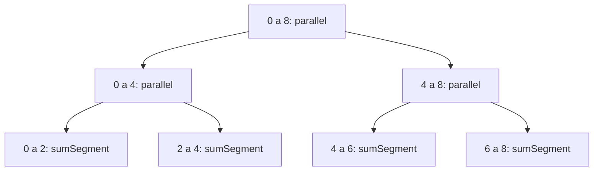
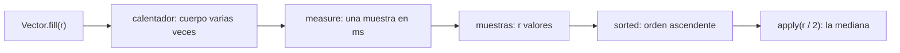
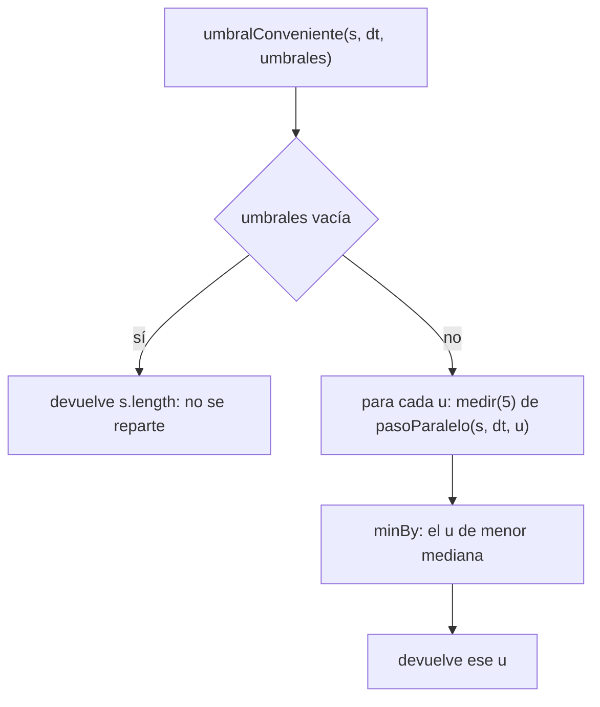

# Suma de potencias sobre un arreglo, repartida con `parallel`

## El cálculo

`sumSegment` recorre un tramo del arreglo y acumula la potencia `p` de cada
elemento. Es una recursión de cola con acumulador.

```scala
import scala.annotation.tailrec

def power(x: Int, p: Double): Double =
  math.pow(math.abs(x.toDouble), p)

def sumSegment(a: Array[Int], p: Double, s: Int, t: Int): Double = {
  @tailrec
  def aux(i: Int, acc: Double): Double =
    if (i >= t) acc
    else aux(i + 1, acc + power(a(i), p))
  aux(s, 0.0)
}
```

En notación matemática, con el tramo entre `s` incluido y `t` excluido:

$$
\text{sumSegment}(a, p, s, t) = \sum_{i=s}^{t-1} |a_i|^{\,p}
$$

Sobre ese cálculo hay dos versiones que dividen el tramo a la mitad mientras
pase del umbral. La diferencia entre las dos es una línea: dónde una resuelve
las dos mitades una tras otra, la otra las entrega a `parallel`. Ambas fijan
`u = max(umbral, 1)`: sin ese ajuste, un umbral menor que 1 haría que un tramo
de un elemento se siguiera partiendo sin reducirse.

```scala
def segmentRecSec(a: Array[Int], p: Double, s: Int, t: Int, umbral: Int): Double = {
  val u = math.max(umbral, 1)
  def rec(s: Int, t: Int): Double =
    if (t - s <= u) sumSegment(a, p, s, t)
    else {
      val m = s + (t - s) / 2
      val sum1 = rec(s, m)
      val sum2 = rec(m, t)
      sum1 + sum2
    }
  rec(s, t)
}

def segmentRecPar(a: Array[Int], p: Double, s: Int, t: Int, umbral: Int): Double = {
  val u = math.max(umbral, 1)
  def rec(s: Int, t: Int): Double =
    if (t - s <= u) sumSegment(a, p, s, t)
    else {
      val m = s + (t - s) / 2
      val (sum1, sum2) = parallel(rec(s, m), rec(m, t))
      sum1 + sum2
    }
  rec(s, t)
}
```

## La estrategia de reparto

El tramo se parte por la mitad en `m`, y cada mitad se resuelve sin mirar la
otra: ningún índice aparece en las dos y ninguno se queda por fuera, porque un
tramo va de `s` a `m` y el otro de `m` a `t`. Por debajo del umbral ya no se
parte y el tramo se resuelve con `sumSegment`.

Lo que combina los resultados parciales es la suma, y la suma es asociativa:

$$
\left(\sum_{i=s}^{m-1} |a_i|^{\,p}\right) + \left(\sum_{i=m}^{t-1} |a_i|^{\,p}\right)
= \sum_{i=s}^{t-1} |a_i|^{\,p}
$$

Por eso el orden en que terminen las dos mitades no cambia el resultado, y por
eso se pueden repartir. El árbol de llamados para un arreglo de ocho elementos
con umbral 2 queda así, con las hojas resolviendo en secuencial:



## Por qué las dos versiones dan lo mismo

- **`sumSegment`.** Su invariante es $acc = \sum_{k=s}^{i-1} |a_k|^p$ con
  $s \le i \le t$. Al inicio ($i = s$) vale 0, la suma vacía. Cada paso suma
  $|a_i|^p$ e incrementa $i$. Cuando $i = t$ queda la suma completa del tramo.
- **Terminación.** Con $u \ge 1$ y $t - s > u$, se cumple $t - s \ge 2$, así que
  $s < m < t$ y las dos mitades son más cortas que el tramo. Por eso la
  recursión termina.
- **Partición.** Los tramos $[s, m)$ y $[m, t)$ son disjuntos y su unión es
  $[s, t)$.
- **Equivalencia.** Por inducción sobre $t - s$: en la hoja las dos versiones
  llaman a `sumSegment`; en el caso recursivo ambas calculan `sum1 + sum2` con
  los mismos valores. `parallel` cambia cuándo se evalúan las mitades, no sus
  valores.
- **Coma flotante.** Las dos versiones usan **el mismo árbol de sumas**, así que
  devuelven exactamente el mismo `Double`, sin importar qué mitad termine
  primero. Además, con enteros entre 1 y 100 y potencia 2, cada término es un
  entero menor o igual que 10 000 y la suma total no pasa de $2 \times 10^{11}$,
  muy por debajo de $2^{53}$. Todas las sumas son exactas y cualquier árbol da
  el mismo valor. Conviene comprobar la igualdad exacta en una prueba antes de
  medir.

## Cómo se tomaron los tiempos

Cada cifra es la media de diez corridas. Antes de esas diez van cinco que no se
cuentan, porque la máquina virtual compila y optimiza el código mientras el
programa corre: las primeras corridas miden una versión del programa que ya no
existe cuando llega la sexta. Al lado de cada media va la desviación de las
diez, que dice cuánto se movió el reloj de una corrida a otra.

```scala
@volatile var sumidero: Double = 0.0   // consume el resultado para que el JIT no lo elimine

def medir(repeticiones: Int, calentamiento: Int)(bloque: => Double): (Double, Double) = {
  @tailrec
  def calentar(k: Int): Unit =
    if (k <= 0) () else { sumidero = bloque; calentar(k - 1) }
  def medirUna(): Double = {
    val t0 = System.nanoTime()
    sumidero = bloque
    (System.nanoTime() - t0) / 1e6
  }
  @tailrec
  def acumular(k: Int, ts: List[Double]): List[Double] =
    if (k <= 0) ts else acumular(k - 1, medirUna() :: ts)
  calentar(calentamiento)
  val ts = acumular(repeticiones, Nil)
  val media = ts.sum / ts.size
  val varianza = ts.map(t => (t - media) * (t - media)).sum / ts.size
  (media, math.sqrt(varianza))
}
```

Las dos versiones recorren el arreglo con la misma función, así que la
diferencia de tiempos es la del reparto. La medición con el umbral igual al
tamaño del arreglo sirve de control: ahí `segmentRecPar` no parte nada y su
tiempo tiene que ser el de `segmentRecSec`.

**Definiciones.** La aceleración es $S = T_{\text{sec}} / T_{\text{par}}$: mayor
que 1 si la versión paralela gana. "Particiones" es el número de veces que se
parte el tramo en el camino más largo de la raíz a una hoja. Las cifras de
aceleración se calcularon con los tiempos sin redondear, por eso pueden
diferir un poco del cociente de las medias que se muestran.

**Entorno.** Procesador: *[completar modelo, núcleos físicos e hilos]*; la
máquina expone 16 procesadores lógicos. JVM y Scala: *[completar versiones]*.
Los arreglos llevan enteros entre 1 y 100 (semilla: *[completar]*), la potencia
que se suma es 2 y los tiempos están en milisegundos.

## Las mediciones

Con el umbral fijo en 1024, según el tamaño del arreglo:

| n | Secuencial | Desv. | Paralela | Desv. | Aceleración |
|---:|---:|---:|---:|---:|---:|
| 100 000 | 0,5 | 0,3 | 0,4 | 0,1 | 1,43 |
| 1 000 000 | 2,4 | 0,1 | 1,0 | 0,1 | 2,30 |
| 5 000 000 | 12,2 | 0,2 | 2,4 | 0,1 | 5,11 |
| 20 000 000 | 48,7 | 1,0 | 8,3 | 0,3 | 5,84 |

Con $n = 100\,000$ la desviación (0,3) es del orden de la media (0,5), así que
esa fila es sobre todo ruido y su aceleración no es confiable.

Con el arreglo fijo en 5 000 000 de elementos, según el umbral. La última
columna es la aceleración que predice la estimación de trabajo y profundidad
del punto 4, con $p = 16$:

| Umbral | Particiones | Paralela | Desv. | Aceleración | Aceleración estimada |
|---:|---:|---:|---:|---:|---:|
| 5 000 000 (control) | 0 | 12,4 | 0,2 | 0,98 | 0,94 |
| 1 250 000 | 2 | 3,3 | 0,1 | 3,73 | 3,20 |
| 312 500 | 4 | 2,2 | 0,1 | 5,54 | 8,00 |
| 78 125 | 6 | 1,9 | 0,1 | **6,45** | 12,80 |
| 19 531 | 9 | 2,1 | 0,1 | 5,76 | 15,51 |
| 4 883 | 10 | 2,2 | 0,1 | 5,46 | 15,75 |
| 1 024 | 13 | 2,2 | 0,0 | 5,45 | 15,97 |
| 256 | 15 | 2,2 | 1,0 | 5,56 | 15,99 |

El tiempo secuencial de referencia de esta segunda tabla es 12,2 ms, con
desviación 0,1.

Las dos tablas salen de corridas distintas, y por eso la fila de 5 000 000 con
umbral 1024 da 2,4 ms en la primera y 2,2 ms en la segunda. Esas dos décimas
son el ruido de la medida, y hay que tenerlas presentes al comparar dos filas
parecidas.

La fila de umbral 256 tiene desviación 1,0 sobre una media de 2,2: casi la
mitad de la media. Es probable que una o dos corridas hayan sufrido una pausa
del recolector de basura. Para confirmarlo conviene repetir esa fila con más
corridas o usar la mediana en lugar de la media.

## Lo que dicen los números

El control responde lo que debía: con umbral 5 000 000 la aceleración es 0,98,
el mismo tiempo de la versión secuencial. Una cifra bastante mayor que 1 en esa
fila diría que las dos versiones no están haciendo el mismo trabajo y que la
comparación no mide el reparto.

Repartir paga cuando hay con qué pagarlo. Con 100 000 elementos la aceleración
apenas llega a 1,43 y el arreglo entero se recorre en medio milisegundo: crear
los llamados cuesta casi tanto como el cálculo. A 5 000 000 la aceleración sube
a 5,11, y a 20 000 000 a 5,84.

El umbral que más conviene no es el más pequeño. El mejor tiempo está en
78 125, que son seis particiones y 64 tramos para 16 procesadores lógicos (4
tramos por procesador). De 19 531 hacia abajo la aceleración baja a 5,5 y se
queda en esa meseta: cada partición agrega dos llamados que hay que repartir, y
por debajo de cierto tamaño ese costo ya no se recupera con el tramo que se
ahorra. La tabla llega hasta 256; para ver si con umbrales aún más pequeños
(64, 16, 1) la aceleración cae, habría que medirlos.

### Comparación con la estimación del punto 4

La estimación del punto 4 cuenta operaciones sobre el árbol de llamados. El
trabajo es $W(n) = n$. La profundidad $D(n, c)$ es el camino más costoso de la
raíz a una hoja: uno por partición más el tramo que queda sin partir. El
tiempo con $p$ procesadores es $T_p = D + W/p$. La aceleración estimada es el
trabajo, que es lo que tarda la versión secuencial en el modelo, dividido entre
ese tiempo:

$$
S_{\text{est}}(n, p, c) = \frac{W(n)}{D(n, c) + \dfrac{W(n)}{p}}
$$

La última columna de la tabla anterior sale de esta fórmula con $n = 5\,000\,000$
y $p = 16$, los procesadores lógicos de la máquina. Si se mide en una máquina con
otro número de núcleos, hay que recalcularla con ese $p$.

**Lo que el modelo dice.** Con el umbral igual al tamaño no se parte: la
profundidad es todo el trabajo y $T_p = n + n/p$. Por eso la estimación da
$16/17 \approx 0{,}94$ y no 1. El modelo suma a la hoja única el término $W/p$,
que en ese caso no existe como trabajo repartido. Por eso el control medido debe
compararse con 1, no con 0,94. De ahí en adelante, cada partición divide la
profundidad entre dos y la aceleración estimada sube hacia $p = 16$. Desde unas
diez particiones, la profundidad ya es despreciable frente a $W/p$ y la
estimación se queda en 15,75 a 15,99, sin importar cuánto más se parta.

**En qué se parecen y en qué no.** Coinciden en la fila de control, donde no se
reparte nada, y en la tendencia: partir más acelera mientras haya pocos tramos
por procesador. En el mejor umbral la medida es 6,45 y la estimada 12,80, es
decir, la medida alcanza apenas la mitad. Se separan en cuanto se parte, porque
el modelo supone tres cosas que el reloj no cumple:

1. Que crear un llamado de `parallel` no cuesta nada. En la máquina, cada
   partición crea una tarea en el `ForkJoinPool`, que hay que encolar, robar y
   esperar con `join`. Con umbral 1 serían cerca de cinco millones de tareas
   para sumar cinco millones de elementos, y ese costo debería pesar más que el
   cálculo de cada hoja. El modelo dice que el umbral 1 es el mejor; el reloj
   probablemente no, pero esa fila no está medida.
2. Que los $p$ procesadores están siempre ocupados con trabajo útil. En la
   máquina, 16 procesadores lógicos no son 16 núcleos completos si hay
   hiperhilos, y todos comparten el ancho de banda de memoria por el que pasa
   el arreglo.
3. Que una operación cuesta lo mismo en cualquier parte. En la máquina influyen
   la caché y el recolector de basura, que el modelo no ve.

La estimación sirve como techo y para comparar umbrales entre sí, no como
pronóstico del reloj.

### Fracción serial (hipótesis)

Con la aceleración medida de 6,45 sobre $p = 16$ procesadores, la ley de Amdahl
da una fracción $f$ del cálculo que se comporta como serie:

$$
S(p) = \frac{1}{f + \dfrac{1 - f}{p}}
\qquad\Longrightarrow\qquad
f = \frac{\dfrac{1}{S} - \dfrac{1}{p}}{1 - \dfrac{1}{p}} \approx 0{,}099
$$

Con ese $f$, el techo de aceleración para otros números de procesadores sería:

| p | 2 | 4 | 8 | 16 | 32 | ∞ |
|---|---:|---:|---:|---:|---:|---:|
| Aceleración máxima | 1,82 | 3,09 | 4,73 | 6,45 | 7,88 | 10,1 |

Esto es una **extrapolación a partir de un solo punto**, no una medida. Un
valor de $f$ cercano a 0,1 sugiere que cerca de una décima parte del tiempo no
escala con los procesadores, y es razonable atribuirlo a partir el arreglo, a
combinar resultados y a la memoria compartida. Pero el ancho de banda de memoria
no es una fracción serial en sentido estricto, y para confirmarlo habría que
medir con 1, 2, 4, 8 y 16 hilos y ajustar la curva. Con esa reserva, pasar de 16
a 32 procesadores agregaría apenas 1,4 a la aceleración.

## Punto 5: medición, aceleración y umbral conveniente

Las tres funciones del punto 5 no calculan nada del sistema de partículas:
miden cuánto tarda el código de los puntos anteriores y comparan resultados.
`medir` cronometra, `aceleracion` compara dos tiempos y `umbralConveniente`
usa `medir` para escoger el umbral que menos tarda. Necesitan
`import org.scalameter._` para `withWarmer`, `Warmer` y `measure`. Los tiempos
de los ejemplos de `medir` son ilustrativos, no mediciones de la máquina.

**Nombre repetido.** Esta `medir` usa ScalaMeter y devuelve la **mediana** de
las muestras. La `medir` de la sección "Cómo se tomaron los tiempos" usa
`System.nanoTime` y devuelve **media y desviación**. Si las dos viven en el
mismo objeto, una debe cambiar de nombre (por ejemplo `medirMediana`).

### 5.1 `medir`

```scala
/** Mediana de varias mediciones de ScalaMeter, en milisegundos. */
def medir[A](repeticiones: Int)(cuerpo: => A): Double = {
  val muestras = Vector.fill(repeticiones) {
    (withWarmer(new Warmer.Default) measure { cuerpo }).value
  }
  muestras.sorted.apply(muestras.length / 2)
}
```

Ejecución paso a paso:

1. `Vector.fill(repeticiones) { ... }` evalúa su bloque `repeticiones` veces y
   guarda cada resultado en un vector.
2. En cada repetición, `withWarmer(new Warmer.Default)` ejecuta `cuerpo` varias
   veces antes de medir, para que la JVM compile y optimice el código.
3. Después, `measure { cuerpo }` mide el tiempo de una ejecución, y `.value`
   toma ese tiempo como `Double`, en milisegundos. Esa cifra es una muestra.
4. `cuerpo: => A` es un parámetro por nombre: se reevalúa en cada muestra y en
   cada repetición del calentador, en lugar de ejecutarse una sola vez.
5. `muestras.sorted` ordena las muestras de menor a mayor.
6. `apply(muestras.length / 2)` toma el elemento del medio. La división es
   entera, así que con una cantidad impar de muestras es la mediana exacta, y
   con una cantidad par es la mediana superior.

Ejemplo con `repeticiones = 5`, donde una muestra salió muy alta por una pausa
del recolector de basura:

```text
medir(5) { pasoParalelo(s, 0.5, 1024) }
  muestras   = Vector(10.2, 9.8, 95.0, 10.1, 10.4)
  sorted     = Vector(9.8, 10.1, 10.2, 10.4, 95.0)
  length / 2 = 5 / 2 = 2
  apply(2)   = 10.2
  resultado: 10.2
```

El promedio de esas mismas muestras sería
$(10{,}2 + 9{,}8 + 95{,}0 + 10{,}1 + 10{,}4) / 5 = 27{,}1$, un valor que
ninguna corrida tuvo. La mediana ignora el valor atípico y se queda con 10,2.
Esto es útil justo en casos como la fila de umbral 256 de las tablas
anteriores, donde la desviación era casi la mitad de la media.

Con una cantidad par, `repeticiones = 4`:

```text
muestras   = Vector(8.0, 6.0, 7.0, 9.0)
sorted     = Vector(6.0, 7.0, 8.0, 9.0)
length / 2 = 4 / 2 = 2
apply(2)   = 8.0
resultado: 8.0   (la mediana superior; la inferior sería 7.0)
```

Con `repeticiones = 0` el vector queda vacío y `apply(0)` lanza una excepción,
porque no hay mediana de una muestra vacía. La función necesita al menos una
repetición.



### 5.2 `aceleracion`

```scala
/** El cociente entre el tiempo secuencial y el paralelo. */
def aceleracion(tSecuencial: Double, tParalelo: Double): Double =
  tSecuencial / tParalelo
```

Paso a paso: divide el tiempo de la versión secuencial entre el de la
paralela. Un resultado mayor que 1 significa que la paralela tardó menos.

| tSecuencial | tParalelo | aceleración | lectura |
|---:|---:|---:|---|
| 12,0 | 3,0 | 4,0 | la paralela es 4 veces más rápida |
| 12,0 | 12,0 | 1,0 | no hay ganancia |
| 12,0 | 24,0 | 0,5 | la paralela es el doble de lenta |

Ejemplo de uso, con los dos tiempos medidos por separado:

```text
tSecuencial = medir(5) { pasoSecuencial(s, 0.5) }       = 12.0
tParalelo   = medir(5) { pasoParalelo(s, 0.5, 78125) }  = 3.0
aceleracion(12.0, 3.0) = 12.0 / 3.0 = 4.0
```

Si `tParalelo` fuera 0, la división en `Double` daría `Infinity`. Con cargas
reales las muestras son positivas, así que ese caso no se espera.

### 5.3 `umbralConveniente`

```scala
/**
 * El umbral que menos tarda de una lista de candidatos. Con la lista vacía,
 * el tamaño del sistema, que equivale a no repartir.
 */
def umbralConveniente(s: Sistema, dt: Double, umbrales: List[Int]): Int =
  if (umbrales.isEmpty) s.length
  else umbrales.minBy(u => medir(5) {
    pasoParalelo(s, dt, u)
  })
```

Ejecución paso a paso:

1. Si la lista de candidatos está vacía, devuelve `s.length`. No hay nada que
   comparar, y un umbral igual al tamaño del sistema no reparte:
   `pasoParalelo` queda como una sola hoja, equivalente a la versión
   secuencial.
2. Si no, `minBy` recorre la lista y calcula, **una vez por candidato**,
   `medir(5) { pasoParalelo(s, dt, u) }`: la mediana de 5 muestras con ese
   umbral.
3. `minBy` se queda con el candidato de menor tiempo. Si hay empate, gana el
   primero de la lista, porque solo reemplaza ante un valor estrictamente
   menor.
4. Devuelve el umbral, no el tiempo.

Ejemplo con tres candidatos:

```text
umbralConveniente(s, 0.5, List(100000, 10000, 1000))
  u = 100000 -> medir(5) { pasoParalelo(s, 0.5, 100000) } = 2.1
  u = 10000  -> medir(5) { pasoParalelo(s, 0.5, 10000)  } = 1.6   <- menor
  u = 1000   -> medir(5) { pasoParalelo(s, 0.5, 1000)   } = 1.8
  resultado: 10000
```

Ejemplo de empate:

```text
umbralConveniente(s, 0.5, List(8, 4))
  u = 8 -> 2.0
  u = 4 -> 2.0
  empate: gana el primero
  resultado: 8
```

Ejemplo con la lista vacía y $n = 4$:

```text
umbralConveniente(s, 0.5, Nil)
  umbrales.isEmpty -> s.length = 4
  resultado: 4   (pasoParalelo(s, 0.5, 4) no crea ninguna tarea)
```



El umbral escogido cambia el tiempo, pero nunca el resultado: todos los
umbrales devuelven el mismo arreglo, como se muestra en el punto 1.

### 5.4 Cómo se usan las tres funciones juntas

El informe de resultados sigue estos pasos:

1. Mide la versión secuencial:
   `tSecuencial = medir(5) { pasoSecuencial(s, dt) }`.
2. Para cada umbral de interés, mide la paralela:
   `tParalelo = medir(5) { pasoParalelo(s, dt, u) }`.
3. Calcula `aceleracion(tSecuencial, tParalelo)` para cada umbral.
4. Llama a `umbralConveniente` con esa lista de umbrales para escoger el mejor.

Como caso de control, el umbral igual al tamaño del sistema no reparte nada, y
la aceleración debe dar cerca de 1. Si da mucho más o mucho menos, el ruido de
la medición es grande y los demás resultados deben leerse con cuidado.

**Relación con las tablas de este informe.** Con los tiempos de la segunda tabla
(5 000 000 de elementos), `aceleracion(12.2, 1.9)` da $12{,}2 / 1{,}9 \approx 6{,}42$
(la tabla muestra 6,45 porque se calculó con tiempos sin redondear). Si se le
pasara a `umbralConveniente` la lista de umbrales de esa tabla, el resultado
sería 78 125, el de menor tiempo (1,9 ms). Dos matices: `medir` de este punto
devuelve medianas y las tablas usan medias, así que los valores pueden
diferir un poco; y como cada candidato se mide solo con 5 repeticiones, dos
umbrales con tiempos muy parecidos (por ejemplo 4 883, 1 024 y 256, todos
cerca de 2,2 ms) pueden quedar en otro orden en otra corrida. Por eso la
función devuelve un umbral *conveniente*, no un óptimo garantizado.

### 5.5 Resumen del flujo de datos

- `medir` repite la medición, ordena las muestras y devuelve la del medio, por
  lo que un valor atípico no la mueve.
- `aceleracion` es un cociente de dos tiempos: mayor que 1 si gana la
  paralela.
- `umbralConveniente` mide cada candidato con `medir(5)` y devuelve el de menor
  tiempo, o el tamaño del sistema si no hay candidatos.
- El resultado de `pasoParalelo` no cambia con el umbral; el informe de
  corrección argumenta por qué.

## Conclusión

- Las dos versiones calculan exactamente la misma suma, así que la comparación
  mide solo el reparto.
- El control (umbral igual a $n$) da 0,98, como se esperaba.
- Repartir solo paga con arreglos grandes: 1,43 con $10^5$ elementos frente a
  5,11 con $5 \times 10^6$.
- El mejor umbral medido para $n = 5 \times 10^6$ es 78 125 (aceleración 6,45),
  unos cuatro tramos por procesador lógico. Por debajo hay una meseta cercana
  a 5,5.
- La estimación del punto 4 sirve de techo y de guía de tendencia, pero
  sobreestima la aceleración porque no cuenta el costo de crear tareas ni el
  límite de la memoria.
- Las funciones del punto 5 automatizan esta comparación: `medir` da tiempos
  robustos con la mediana, `aceleracion` los resume en un cociente y
  `umbralConveniente` elige el umbral de menor tiempo.