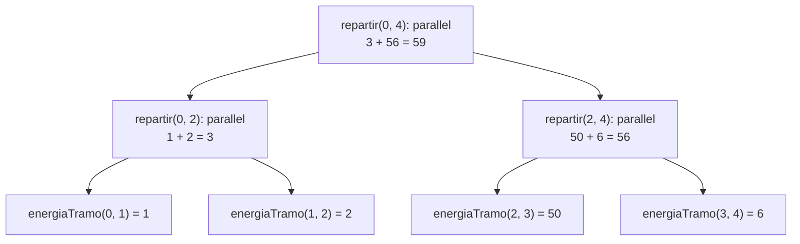
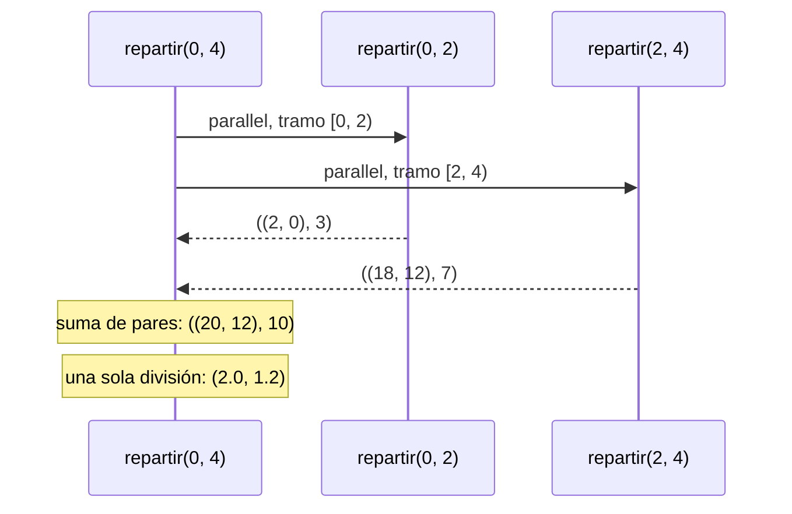
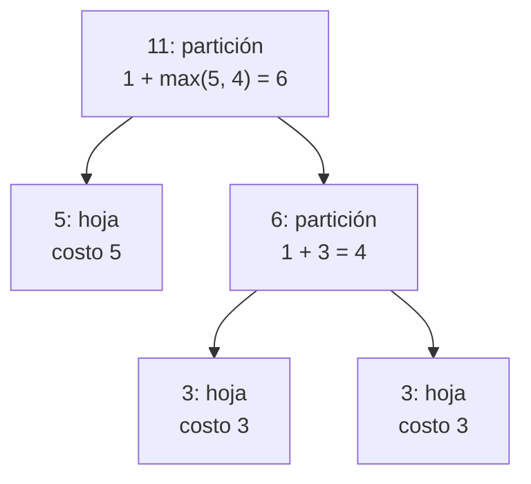

# Informe de proceso

## Punto 3: las magnitudes globales en paralelo

Las dos funciones del punto 3 tienen la misma forma: una función interna que
resuelve un tramo `[desde, hasta)` en secuencial con recursión de cola, y otra,
`repartir`, que parte el tramo por la mitad con `parallel` mientras tenga más
elementos que el umbral. Lo único que cambia entre las dos es **qué** se
acumula en cada tramo y **cómo** se combinan las dos mitades.

Un umbral cero o negativo se trata como 1 (`corte = math.max(umbral, 1)`). Sin
eso, un tramo de un elemento con umbral 0 se seguiría partiendo para siempre.

### `energiaParalela`

```Scala
def energiaParalela(s: Sistema, umbral: Int): Double = {
  val corte = math.max(umbral, 1)

  def energiaTramo(desde: Int, hasta: Int): Double = {
    @annotation.tailrec
    def acumular(i: Int, acc: Double): Double =
      if (i >= hasta) acc
      else {
        val v = s(i).vel.norma
        acumular(i + 1, acc + 0.5 * s(i).masa * v * v)
      }
    acumular(desde, 0.0)
  }

  def repartir(desde: Int, hasta: Int): Double =
    if (hasta - desde <= corte) energiaTramo(desde, hasta)
    else {
      val medio = desde + (hasta - desde) / 2
      val (izquierda, derecha) = parallel(repartir(desde, medio), repartir(medio, hasta))
      izquierda + derecha
    }

  repartir(0, s.length)
}
```

* `energiaTramo` recorre el tramo con el índice `i` y lleva en `acc` la
  energía de las partículas ya vistas. Cuando `i` llega a `hasta`, devuelve
  `acc`.
* `repartir` decide: si el tramo cabe en el umbral, lo resuelve
  `energiaTramo`; si no, calcula el punto medio y entrega las dos mitades a
  `parallel`. Las energías de las dos mitades se **suman**.

#### Ejemplo

Cuatro partículas, con su energía $\tfrac{1}{2} m v^2$ al lado:

| Índice | Velocidad | Masa | Energía |
|---:|---|---:|---:|
| 0 | (1, 0) | 2 | 1 |
| 1 | (0, −2) | 1 | 2 |
| 2 | (−3, 4) | 4 | 50 |
| 3 | (1, 1) | 6 | 6 |

Traza de `energiaParalela(s, 1)`:

```Scala
energiaParalela(s, 1)
repartir(0, 4)                 // 4 > 1: medio = 2
  parallel(repartir(0, 2), repartir(2, 4))
  repartir(0, 2)               // 2 > 1: medio = 1
    parallel(repartir(0, 1), repartir(1, 2))
    repartir(0, 1)  ->  energiaTramo(0, 1)  ->  1.0
    repartir(1, 2)  ->  energiaTramo(1, 2)  ->  2.0
    1.0 + 2.0  ->  3.0
  repartir(2, 4)               // 2 > 1: medio = 3
    parallel(repartir(2, 3), repartir(3, 4))
    repartir(2, 3)  ->  energiaTramo(2, 3)  ->  50.0
    repartir(3, 4)  ->  energiaTramo(3, 4)  ->  6.0
    50.0 + 6.0  ->  56.0
  3.0 + 56.0  ->  59.0
```

Con umbral 2 se parte una sola vez, y cada hoja recorre dos partículas con la
recursión de cola:

```Scala
repartir(0, 4)                 // 4 > 2: medio = 2
  repartir(0, 2)  ->  energiaTramo(0, 2)
    acumular(0, 0.0)  ->  acumular(1, 1.0)  ->  acumular(2, 3.0)  ->  3.0
  repartir(2, 4)  ->  energiaTramo(2, 4)
    acumular(2, 0.0)  ->  acumular(3, 50.0)  ->  acumular(4, 56.0)  ->  56.0
  3.0 + 56.0  ->  59.0
```

El árbol de llamados con umbral 1. Cada hoja resuelve un tramo y cada nodo
interno suma lo que le devuelven sus dos hijos:



### `centroDeMasaParalelo`

```Scala
def centroDeMasaParalelo(s: Sistema, umbral: Int): Vector2 = {
  val corte = math.max(umbral, 1)

  def resumenTramo(desde: Int, hasta: Int): (Vector2, Double) = {
    @annotation.tailrec
    def acumular(i: Int, suma: Vector2, masa: Double): (Vector2, Double) =
      if (i >= hasta) (suma, masa)
      else acumular(i + 1, suma + s(i).pos * s(i).masa, masa + s(i).masa)
    acumular(desde, Vector2(0, 0), 0.0)
  }

  def repartir(desde: Int, hasta: Int): (Vector2, Double) =
    if (hasta - desde <= corte) resumenTramo(desde, hasta)
    else {
      val medio = desde + (hasta - desde) / 2
      val ((sumaIzq, masaIzq), (sumaDer, masaDer)) =
        parallel(repartir(desde, medio), repartir(medio, hasta))
      (sumaIzq + sumaDer, masaIzq + masaDer)
    }

  val (suma, masa) = repartir(0, s.length)
  if (masa == 0.0) Vector2(0, 0) else Vector2(suma.x / masa, suma.y / masa)
}
```

Aquí está la trampa del enunciado: un tramo **no** devuelve su centro de masa,
sino un par con la suma de las posiciones ponderadas por la masa y la masa del
tramo. Los pares de las dos mitades se suman componente a componente, y la
división se hace **una sola vez**, al final, sobre el par del sistema
completo. Si la masa total es cero, el resultado es el origen; como ninguna
mitad divide, una mitad sin masa tampoco produce `NaN`.

#### Ejemplo

| Índice | Posición | Masa | Posición × masa |
|---:|---|---:|---|
| 0 | (0, 0) | 1 | (0, 0) |
| 1 | (1, 0) | 2 | (2, 0) |
| 2 | (2, 4) | 3 | (6, 12) |
| 3 | (3, 0) | 4 | (12, 0) |

Traza de `centroDeMasaParalelo(s, 2)`:

```Scala
repartir(0, 4)                          // 4 > 2: medio = 2
  parallel(repartir(0, 2), repartir(2, 4))
  repartir(0, 2)  ->  resumenTramo(0, 2)
    acumular(0, (0, 0), 0)
    acumular(1, (0, 0), 1)              // + (0, 0) * 1
    acumular(2, (2, 0), 3)              // + (1, 0) * 2
    ->  ((2, 0), 3)
  repartir(2, 4)  ->  resumenTramo(2, 4)
    acumular(2, (0, 0), 0)
    acumular(3, (6, 12), 3)             // + (2, 4) * 3
    acumular(4, (18, 12), 7)            // + (3, 0) * 4
    ->  ((18, 12), 7)
  ((2, 0) + (18, 12), 3 + 7)  ->  ((20, 12), 10)
masa = 10 != 0  ->  (20 / 10, 12 / 10)  ->  Vector2(2.0, 1.2)
```

Si cada mitad devolviera su centro de masa, la izquierda daría
$(2/3,\ 0)$ y la derecha $(18/7,\ 12/7)$, y su promedio sería
$(1{,}62;\ 0{,}86)$, que no es el centro del sistema: la mitad derecha pesa 7
y la izquierda 3, y el promedio las cuenta igual.



## Punto 4: trabajo y profundidad

Las tres funciones no ejecutan la simulación: cuentan cuánto costaría el
árbol de llamados de `repartir` sobre `n` partículas.

```Scala
def trabajo(n: Int): Int = n

def profundidad(n: Int, umbral: Int): Int = {
  val corte = math.max(umbral, 1)
  def camino(tramo: Int): Int =
    if (tramo <= corte) tramo
    else if (tramo % 2 == 0) 1 + camino(tramo / 2)
    else 1 + math.max(camino(tramo / 2), camino(tramo - tramo / 2))
  camino(n)
}

def tiempoEstimado(n: Int, p: Int, umbral: Int): Double =
  profundidad(n, umbral) + trabajo(n).toDouble / p
```

* `trabajo` cuenta una operación por partícula. No depende del umbral: las
  hojas del árbol cubren cada partícula una sola vez.
* `profundidad` sigue el camino más costoso desde la raíz hasta una hoja. Cada
  partición suma 1, y la hoja suma el tamaño del tramo que se resuelve en
  secuencial. Un tramo par se parte en dos mitades iguales, así que basta con
  seguir una. Un tramo impar se parte en $\lfloor k/2 \rfloor$ y
  $\lceil k/2 \rceil$, que pueden costar distinto, y se toma la más costosa.
* `tiempoEstimado` suma la profundidad y el trabajo repartido entre `p`
  procesadores. La división se hace en `Double`.

### Traza de `profundidad(1000, 100)`

```Scala
camino(1000)                 // 1000 > 100, par
1 + camino(500)              // par
1 + 1 + camino(250)          // par
1 + 1 + 1 + camino(125)      // impar: mitades 62 y 63
1 + 1 + 1 + 1 + max(camino(62), camino(63))
1 + 1 + 1 + 1 + max(62, 63)  // las dos caben en el umbral
4 + 63  ->  67
```

Y `tiempoEstimado(1000, 4, 100) = 67 + 1000 / 4 = 317.0`.

### Por qué hace falta el máximo: `profundidad(11, 5)`

```Scala
camino(11)                         // 11 > 5, impar: mitades 5 y 6
1 + max(camino(5), camino(6))
camino(5)  ->  5                   // cabe en el umbral: tramo de 5
camino(6)  ->  1 + camino(3)  ->  1 + 3  ->  4
1 + max(5, 4)  ->  6
```

La mitad mayor, la de 6, se parte otra vez y termina en hojas de 3. La mitad
menor, la de 5, ya no se parte y su hoja cuesta 5. El camino crítico pasa por
la mitad **menor**, y seguir solo la mayor daría 5 en lugar de 6.


