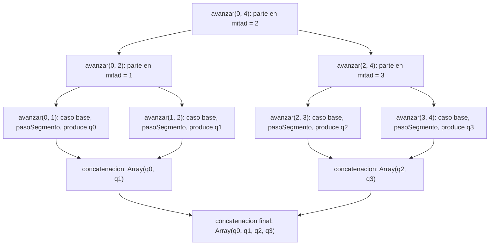
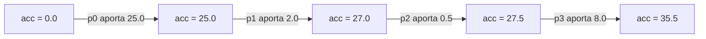
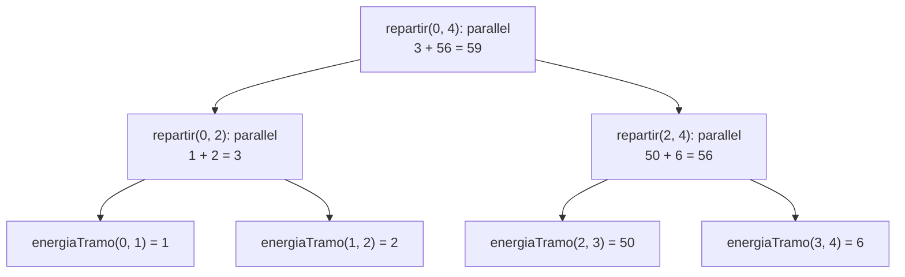
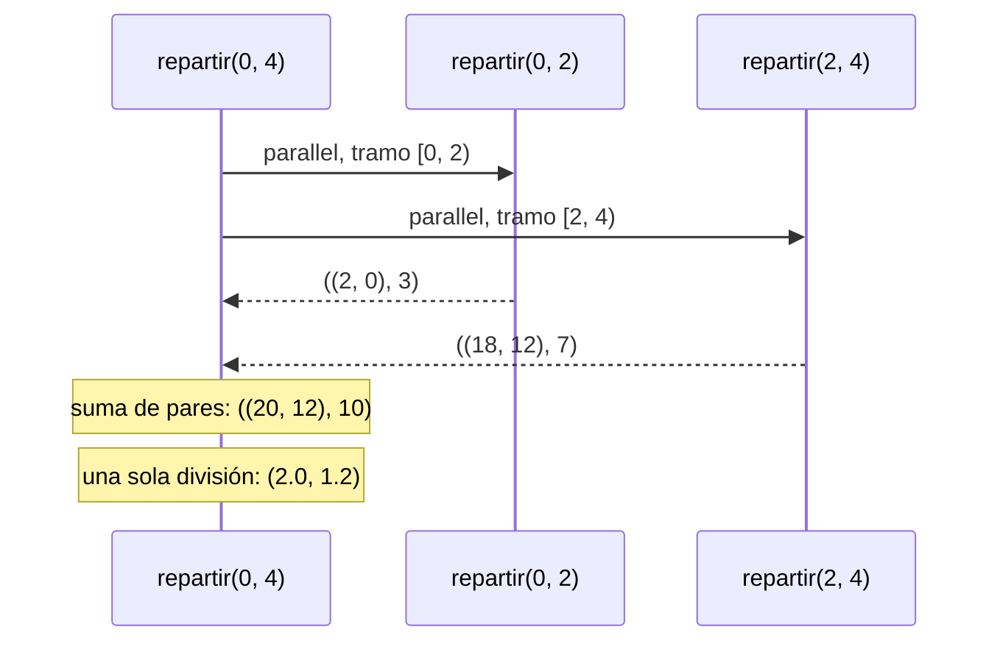
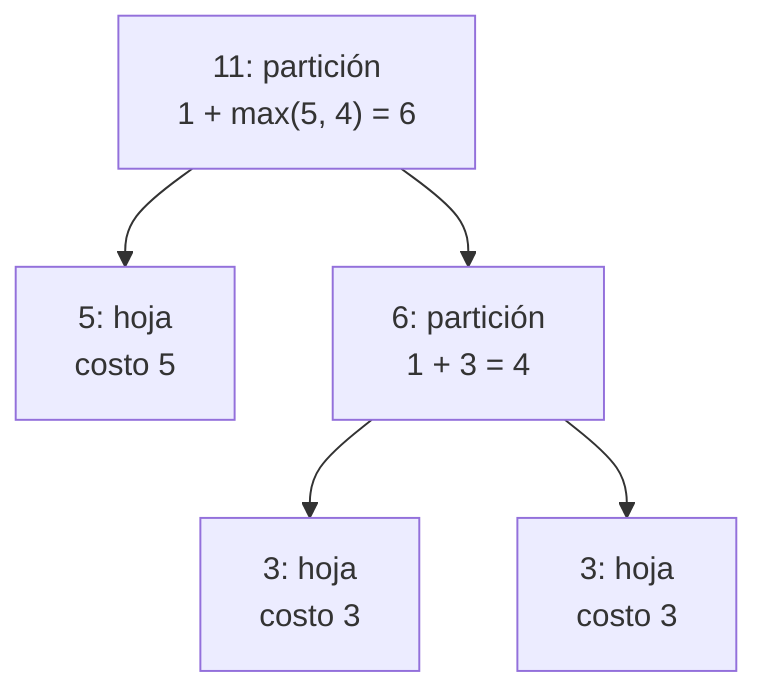
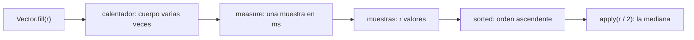
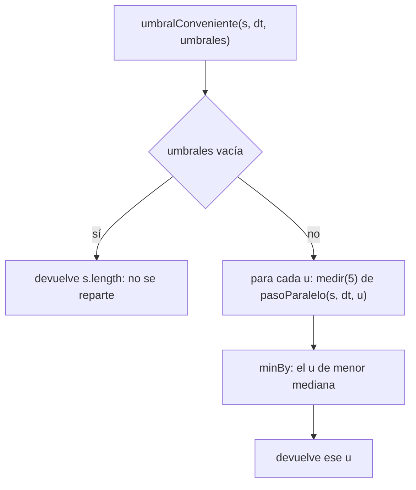

# Informe de proceso

## 1. Punto 1: un paso de la simulación

### 1.1 La auxiliar `mover`

```scala
def mover(p: Particula, dt: Double): Particula =
  Particula(p.pos + p.vel * dt, p.vel, p.masa)
```

`mover` construye una partícula nueva: la posición es la anterior más la velocidad
escalada por `dt`; la velocidad y la masa se copian sin cambio. No modifica `p`,
porque `Particula` y `Vector2` son inmutables.

Ejemplo con `p0` y `dt = 0.5`:

1. `p.vel * dt` = `(3, 4) * 0.5` = `(1.5, 2.0)`.
2. `p.pos + (1.5, 2.0)` = `(1, 2) + (1.5, 2.0)` = `(2.5, 4.0)`.
3. Resultado: `Particula(Vector2(2.5, 4.0), Vector2(3, 4), 2.0)`.

En el código, `pasoSegmento` no llama a `mover` sino que aplica inline la misma
expresión `Particula(p.pos + p.vel * dt, p.vel, p.masa)`, así que el efecto es
idéntico.

### 1.2 `pasoSegmento`: el núcleo del cálculo

```scala
def pasoSegmento(s: Sistema, dt: Double, desde: Int, hasta: Int): Sistema = {
  Array.tabulate(hasta - desde) { i =>
    val p = s(desde + i)
    Particula(p.pos + p.vel * dt, p.vel, p.masa)
  }
}
```

Ejecución paso a paso:

1. Calcula el tamaño del tramo: `k = hasta - desde`.
2. `Array.tabulate(k)` crea un arreglo nuevo de tamaño `k` y evalúa la función
   cuerpo con `i` tomando los valores locales `0, 1, ..., k - 1`.
3. Para cada `i` local, el índice global en `s` es `desde + i`, que recorre
   exactamente `desde, desde + 1, ..., hasta - 1`.
4. Cada posición del arreglo nuevo se llena con la partícula movida. El arreglo
   original `s` solo se lee; nunca se escribe.

Ejemplo: `pasoSegmento(s, 0.5, 1, 3)`. El tramo es `[1, 3)`, de tamaño `k = 2`.

| i local | índice global desde + i | posición anterior | vel por dt | posición nueva |
|---------|-------------------------|-------------------|------------|----------------|
| 0       | 1                       | (4.0, 0.0)        | (0.0, 1.0) | (4.0, 1.0)     |
| 1       | 2                       | (-2.0, 6.0)       | (0.5, 0.0) | (-1.5, 6.0)    |

Traza:

```text
pasoSegmento(s, 0.5, 1, 3)
  k = 3 - 1 = 2
  Array.tabulate(2):
    i = 0 -> lee s(1) -> Particula(Vector2(4.0, 1.0),  Vector2(0, 2), 1.0)
    i = 1 -> lee s(2) -> Particula(Vector2(-1.5, 6.0), Vector2(1, 0), 1.0)
  resultado: arreglo de 2 partículas, en el orden del tramo
```

El resultado tiene exactamente `hasta - desde` elementos: ni el índice `desde - 1`
ni el índice `hasta` quedan incluidos.

### 1.3 `pasoSecuencial`: el tramo completo

```scala
def pasoSecuencial(s: Sistema, dt: Double): Sistema = {
  pasoSegmento(s, dt, 0, s.length)
}
```

Es una delegación directa: cubre el tramo `[0, n)`, que es todo el sistema. No hay
recursión ni reparto; un solo llamado a `pasoSegmento` recorre las partículas de
izquierda a derecha.

Ejemplo: `pasoSecuencial(s, 0.5)` con `n = 4`.

```text
pasoSecuencial(s, 0.5)
  pasoSegmento(s, 0.5, 0, 4)
    k = 4
    i = 0 -> s(0): (1, 2)  + (1.5, 2.0) = (2.5, 4.0)
    i = 1 -> s(1): (4, 0)  + (0.0, 1.0) = (4.0, 1.0)
    i = 2 -> s(2): (-2, 6) + (0.5, 0.0) = (-1.5, 6.0)
    i = 3 -> s(3): (0, -4) + (0.0, -1.0) = (0.0, -5.0)
```

Llamemos `q0, q1, q2, q3` a las cuatro partículas movidas, en ese orden. El
resultado es `Array(q0, q1, q2, q3)`. Esta notación se usa también en la traza de
`pasoParalelo` para comparar ambas versiones.

### 1.4 `pasoParalelo`: reparto por mitades

```scala
def pasoParalelo(s: Sistema, dt: Double, umbral: Int): Sistema = {
  val u = math.max(umbral, 1)
  def avanzar(desde: Int, hasta: Int): Sistema =
    if (hasta - desde <= u) pasoSegmento(s, dt, desde, hasta)
    else {
      val mitad = desde + (hasta - desde) / 2
      val (izq, der) = parallel(avanzar(desde, mitad), avanzar(mitad, hasta))
      izq ++ der
    }
  avanzar(0, s.length)
}
```

Ejecución paso a paso:

1. Se fija `u = max(umbral, 1)`. Para `umbral >= 1` el comportamiento es el del
   enunciado; el máximo solo protege contra umbrales menores que 1, que harían
   que un tramo de un elemento se siguiera partiendo sin reducirse.
2. El llamado interno `avanzar(desde, hasta)` mide el tramo: `L = hasta - desde`.
3. Caso base: si `L <= u`, el tramo se resuelve en secuencial con `pasoSegmento`,
   sin crear tareas.
4. Caso recursivo: si `L > u`, se calcula `mitad = desde + L / 2` (división entera)
   y se lanzan con `parallel` dos llamados: el izquierdo sobre `[desde, mitad)` y
   el derecho sobre `[mitad, hasta)`. El punto `mitad` es el inicio del derecho y
   no pertenece al izquierdo, así que ningún índice se procesa dos veces.
5. Cuando ambas mitades terminan, `izq ++ der` concatena los dos arreglos
   parciales: primero los del tramo izquierdo, después los del derecho. La
   concatenación restituye el orden original de los índices.
6. El llamado raíz `avanzar(0, n)` devuelve el sistema completo movido.

Ejemplo: `pasoParalelo(s, 0.5, 1)` con `n = 4`. Cada tramo de más de un elemento
se parte, así que se llega hasta tramos de un solo elemento.

```text
pasoParalelo(s, 0.5, 1)
  u = 1
  avanzar(0, 4): L = 4 > 1, mitad = 0 + 4/2 = 2
    parallel(
      avanzar(0, 2): L = 2 > 1, mitad = 0 + 2/2 = 1
        parallel(
          avanzar(0, 1): L = 1 <= 1 -> pasoSegmento(s, 0.5, 0, 1) -> Array(q0)
          avanzar(1, 2): L = 1 <= 1 -> pasoSegmento(s, 0.5, 1, 2) -> Array(q1)
        )
        izq ++ der -> Array(q0, q1)
      ,
      avanzar(2, 4): L = 2 > 1, mitad = 2 + 2/2 = 3
        parallel(
          avanzar(2, 3): L = 1 <= 1 -> pasoSegmento(s, 0.5, 2, 3) -> Array(q2)
          avanzar(3, 4): L = 1 <= 1 -> pasoSegmento(s, 0.5, 3, 4) -> Array(q3)
        )
        izq ++ der -> Array(q2, q3)
    )
    izq ++ der -> Array(q0, q1, q2, q3)
```

Árbol de llamados y combinación de resultados parciales:



Los dos hijos de cada nodo se ejecutan con `parallel`; las hojas son llamados a
`pasoSegmento`. Cada hoja resuelve un tramo distinto:

| Hoja | Tramo | Partículas que mueve | Resultado parcial |
|------|-------|----------------------|-------------------|
| avanzar(0, 1) | [0, 1) | p0 | Array(q0) |
| avanzar(1, 2) | [1, 2) | p1 | Array(q1) |
| avanzar(2, 3) | [2, 3) | p2 | Array(q2) |
| avanzar(3, 4) | [3, 4) | p3 | Array(q3) |

La combinación sube por el árbol: `Array(q0) ++ Array(q1)` y
`Array(q2) ++ Array(q3)` en el primer nivel, y luego
`Array(q0, q1) ++ Array(q2, q3)` en la raíz. El resultado final es
`Array(q0, q1, q2, q3)`, idéntico al de `pasoSecuencial(s, 0.5)`.

### 1.5 El umbral controla la profundidad del reparto

Con el mismo sistema y `umbral = 2`, el reparto se detiene antes:

```text
pasoParalelo(s, 0.5, 2)
  u = 2
  avanzar(0, 4): L = 4 > 2, mitad = 2
    parallel(
      avanzar(0, 2): L = 2 <= 2 -> pasoSegmento(s, 0.5, 0, 2) -> Array(q0, q1)
      avanzar(2, 4): L = 2 <= 2 -> pasoSegmento(s, 0.5, 2, 4) -> Array(q2, q3)
    )
    izq ++ der -> Array(q0, q1, q2, q3)
```

Solo hay un nivel de `parallel` y dos hojas de dos elementos cada una. El
resultado es el mismo; lo único que cambia es la granularidad del reparto.

Con `umbral = 4` (igual al tamaño del sistema), `avanzar(0, 4)` entra directo al
caso base: no se crea ninguna tarea y el cálculo es exactamente el de
`pasoSecuencial`. Este es el caso de control que pide el punto 5.

Con el sistema vacío, `avanzar(0, 0)` tiene `L = 0 <= u`, llama a
`pasoSegmento(s, dt, 0, 0)` y `Array.tabulate(0)` produce un arreglo vacío.

## 2. Punto 2: magnitudes globales

Las tres funciones recorren el sistema con `foldLeft`, que lleva un acumulador
de izquierda a derecha: parte de un valor inicial y lo actualiza con cada
partícula, en orden de índice. El sistema de ejemplo es el mismo de la sección 1.

### 2.1 `masaTotal`

```scala
def masaTotal(s: Sistema): Double = {
  s.foldLeft(0.0)((acc, p) => acc + p.masa)
}
```

Paso a paso: el acumulador empieza en `0.0` y a cada partícula le suma su masa.

```text
masaTotal(s)
  acc = 0.0
  p0: acc = 0.0 + 2.0 = 2.0
  p1: acc = 2.0 + 1.0 = 3.0
  p2: acc = 3.0 + 1.0 = 4.0
  p3: acc = 4.0 + 4.0 = 8.0
  resultado: 8.0
```

Con el arreglo vacío, `foldLeft` devuelve el inicial: `0.0`.

### 2.2 `energiaSecuencial`

```scala
def energiaSecuencial(s: Sistema): Double = {
  s.foldLeft(0.0) { (acc, p) =>
    val v = p.vel.norma
    acc + 0.5 * p.masa * v * v
  }
}
```

Paso a paso, por cada partícula:

1. Calcula `v`, la norma de la velocidad: `Math.sqrt(x * x + y * y)`.
2. Calcula el aporte de energía cinética: `0.5 * masa * v * v`.
3. Suma el aporte al acumulador, que empieza en `0.0`.

Aportes del ejemplo:

| Partícula | vel | norma v | aporte 0.5 por masa por v por v |
|-----------|------|---------|----------------------------------|
| p0 | (3, 4)  | 5.0 | 0.5 por 2.0 por 25.0 = 25.0 |
| p1 | (0, 2)  | 2.0 | 0.5 por 1.0 por 4.0 = 2.0    |
| p2 | (1, 0)  | 1.0 | 0.5 por 1.0 por 1.0 = 0.5    |
| p3 | (0, -2) | 2.0 | 0.5 por 4.0 por 4.0 = 8.0    |

Traza del acumulador:

```text
energiaSecuencial(s)
  acc = 0.0
  p0: v = sqrt(9 + 16) = 5.0, acc = 0.0 + 25.0 = 25.0
  p1: v = sqrt(0 + 4)  = 2.0, acc = 25.0 + 2.0 = 27.0
  p2: v = sqrt(1 + 0)  = 1.0, acc = 27.0 + 0.5 = 27.5
  p3: v = sqrt(0 + 4)  = 2.0, acc = 27.5 + 8.0 = 35.5
  resultado: 35.5
```



Con el arreglo vacío el resultado es `0.0`: la suma sin términos es el inicial.

### 2.3 `centroDeMasaSecuencial`

```scala
def centroDeMasaSecuencial(s: Sistema): Vector2 = {
  val m = masaTotal(s)
  if (m == 0.0) Vector2(0.0, 0.0)
  else {
    val suma = s.foldLeft(Vector2(0.0, 0.0))((acc, p) => acc + p.pos * p.masa)
    suma * (1.0 / m)
  }
}
```

Paso a paso:

1. Llama a `masaTotal(s)` para obtener la masa total `m`. En el ejemplo, `m = 8.0`
   (traza de la sección 3.1).
2. Si `m == 0.0`, devuelve el origen `Vector2(0.0, 0.0)` y termina. Esto cubre el
   sistema vacío y cualquier sistema cuya masa total sea cero.
3. Si no, acumula la suma ponderada de posiciones: el acumulador es un `Vector2`
   que empieza en `(0.0, 0.0)` y a cada paso suma `p.pos * p.masa`.
4. Escala la suma por `1.0 / m`, lo que divide cada componente entre la masa
   total. La división se hace una sola vez, al final.

Traza con el ejemplo (`m = 8.0`, distinto de cero):

```text
centroDeMasaSecuencial(s)
  m = masaTotal(s) = 8.0
  suma = (0.0, 0.0)
  p0: pos * masa = (1, 2) * 2.0  = (2.0, 4.0),   suma = (2.0, 4.0)
  p1: pos * masa = (4, 0) * 1.0  = (4.0, 0.0),   suma = (6.0, 4.0)
  p2: pos * masa = (-2, 6) * 1.0 = (-2.0, 6.0),  suma = (4.0, 10.0)
  p3: pos * masa = (0, -4) * 4.0 = (0.0, -16.0), suma = (4.0, -6.0)
  resultado = (4.0, -6.0) * (1.0 / 8.0) = (0.5, -0.75)
```

Con el sistema vacío: `masaTotal` devuelve `0.0`, la rama `m == 0.0` se activa y
el resultado es `(0.0, 0.0)` sin recorrer nada más.

## 2.4. Resumen del flujo de datos

- `pasoSecuencial` delega en `pasoSegmento` sobre `[0, n)`; un solo recorrido.
- `pasoParalelo` descompone `[0, n)` en tramos disjuntos que `pasoSegmento`
  resuelve en las hojas; `++` combina los arreglos parciales en orden.
- `masaTotal` y `energiaSecuencial` son pliegues con acumulador escalar y valor
  inicial `0.0`.
- `centroDeMasaSecuencial` reutiliza `masaTotal`, pliega con acumulador vectorial
  y divide una sola vez al final; con masa total cero devuelve el origen.

Las dos versiones del paso producen el mismo arreglo sobre el mismo ejemplo, y
el informe de corrección argumenta por qué ocurre lo mismo para cualquier
sistema, cualquier `dt` y cualquier umbral.

## Punto 3: las magnitudes globales en paralelo

Las dos funciones del punto 3 tienen la misma forma: una función interna que
resuelve un tramo `[desde, hasta)` en secuencial con recursión de cola, y otra,
`repartir`, que parte el tramo por la mitad con `parallel` mientras tenga más
elementos que el umbral. Lo único que cambia entre las dos es **qué** se
acumula en cada tramo y **cómo** se combinan las dos mitades.

Un umbral cero o negativo se trata como 1 (`corte = math.max(umbral, 1)`). Sin
eso, un tramo de un elemento con umbral 0 se seguiría partiendo para siempre.

### `energiaParalela`

```Scala
def energiaParalela(s: Sistema, umbral: Int): Double = {
  val corte = math.max(umbral, 1)

  def energiaTramo(desde: Int, hasta: Int): Double = {
    @annotation.tailrec
    def acumular(i: Int, acc: Double): Double =
      if (i >= hasta) acc
      else {
        val v = s(i).vel.norma
        acumular(i + 1, acc + 0.5 * s(i).masa * v * v)
      }
    acumular(desde, 0.0)
  }

  def repartir(desde: Int, hasta: Int): Double =
    if (hasta - desde <= corte) energiaTramo(desde, hasta)
    else {
      val medio = desde + (hasta - desde) / 2
      val (izquierda, derecha) = parallel(repartir(desde, medio), repartir(medio, hasta))
      izquierda + derecha
    }

  repartir(0, s.length)
}
```

* `energiaTramo` recorre el tramo con el índice `i` y lleva en `acc` la
  energía de las partículas ya vistas. Cuando `i` llega a `hasta`, devuelve
  `acc`.
* `repartir` decide: si el tramo cabe en el umbral, lo resuelve
  `energiaTramo`; si no, calcula el punto medio y entrega las dos mitades a
  `parallel`. Las energías de las dos mitades se **suman**.

#### Ejemplo

Cuatro partículas, con su energía $\tfrac{1}{2} m v^2$ al lado:

| Índice | Velocidad | Masa | Energía |
|---:|---|---:|---:|
| 0 | (1, 0) | 2 | 1 |
| 1 | (0, −2) | 1 | 2 |
| 2 | (−3, 4) | 4 | 50 |
| 3 | (1, 1) | 6 | 6 |

Traza de `energiaParalela(s, 1)`:

```Scala
energiaParalela(s, 1)
repartir(0, 4)                 // 4 > 1: medio = 2
  parallel(repartir(0, 2), repartir(2, 4))
  repartir(0, 2)               // 2 > 1: medio = 1
    parallel(repartir(0, 1), repartir(1, 2))
    repartir(0, 1)  ->  energiaTramo(0, 1)  ->  1.0
    repartir(1, 2)  ->  energiaTramo(1, 2)  ->  2.0
    1.0 + 2.0  ->  3.0
  repartir(2, 4)               // 2 > 1: medio = 3
    parallel(repartir(2, 3), repartir(3, 4))
    repartir(2, 3)  ->  energiaTramo(2, 3)  ->  50.0
    repartir(3, 4)  ->  energiaTramo(3, 4)  ->  6.0
    50.0 + 6.0  ->  56.0
  3.0 + 56.0  ->  59.0
```

Con umbral 2 se parte una sola vez, y cada hoja recorre dos partículas con la
recursión de cola:

```Scala
repartir(0, 4)                 // 4 > 2: medio = 2
  repartir(0, 2)  ->  energiaTramo(0, 2)
    acumular(0, 0.0)  ->  acumular(1, 1.0)  ->  acumular(2, 3.0)  ->  3.0
  repartir(2, 4)  ->  energiaTramo(2, 4)
    acumular(2, 0.0)  ->  acumular(3, 50.0)  ->  acumular(4, 56.0)  ->  56.0
  3.0 + 56.0  ->  59.0
```

El árbol de llamados con umbral 1. Cada hoja resuelve un tramo y cada nodo
interno suma lo que le devuelven sus dos hijos:



### `centroDeMasaParalelo`

```Scala
def centroDeMasaParalelo(s: Sistema, umbral: Int): Vector2 = {
  val corte = math.max(umbral, 1)

  def resumenTramo(desde: Int, hasta: Int): (Vector2, Double) = {
    @annotation.tailrec
    def acumular(i: Int, suma: Vector2, masa: Double): (Vector2, Double) =
      if (i >= hasta) (suma, masa)
      else acumular(i + 1, suma + s(i).pos * s(i).masa, masa + s(i).masa)
    acumular(desde, Vector2(0, 0), 0.0)
  }

  def repartir(desde: Int, hasta: Int): (Vector2, Double) =
    if (hasta - desde <= corte) resumenTramo(desde, hasta)
    else {
      val medio = desde + (hasta - desde) / 2
      val ((sumaIzq, masaIzq), (sumaDer, masaDer)) =
        parallel(repartir(desde, medio), repartir(medio, hasta))
      (sumaIzq + sumaDer, masaIzq + masaDer)
    }

  val (suma, masa) = repartir(0, s.length)
  if (masa == 0.0) Vector2(0, 0) else Vector2(suma.x / masa, suma.y / masa)
}
```

Aquí está la trampa del enunciado: un tramo **no** devuelve su centro de masa,
sino un par con la suma de las posiciones ponderadas por la masa y la masa del
tramo. Los pares de las dos mitades se suman componente a componente, y la
división se hace **una sola vez**, al final, sobre el par del sistema
completo. Si la masa total es cero, el resultado es el origen; como ninguna
mitad divide, una mitad sin masa tampoco produce `NaN`.

#### Ejemplo

| Índice | Posición | Masa | Posición × masa |
|---:|---|---:|---|
| 0 | (0, 0) | 1 | (0, 0) |
| 1 | (1, 0) | 2 | (2, 0) |
| 2 | (2, 4) | 3 | (6, 12) |
| 3 | (3, 0) | 4 | (12, 0) |

Traza de `centroDeMasaParalelo(s, 2)`:

```Scala
repartir(0, 4)                          // 4 > 2: medio = 2
  parallel(repartir(0, 2), repartir(2, 4))
  repartir(0, 2)  ->  resumenTramo(0, 2)
    acumular(0, (0, 0), 0)
    acumular(1, (0, 0), 1)              // + (0, 0) * 1
    acumular(2, (2, 0), 3)              // + (1, 0) * 2
    ->  ((2, 0), 3)
  repartir(2, 4)  ->  resumenTramo(2, 4)
    acumular(2, (0, 0), 0)
    acumular(3, (6, 12), 3)             // + (2, 4) * 3
    acumular(4, (18, 12), 7)            // + (3, 0) * 4
    ->  ((18, 12), 7)
  ((2, 0) + (18, 12), 3 + 7)  ->  ((20, 12), 10)
masa = 10 != 0  ->  (20 / 10, 12 / 10)  ->  Vector2(2.0, 1.2)
```

Si cada mitad devolviera su centro de masa, la izquierda daría
$(2/3,\ 0)$ y la derecha $(18/7,\ 12/7)$, y su promedio sería
$(1{,}62;\ 0{,}86)$, que no es el centro del sistema: la mitad derecha pesa 7
y la izquierda 3, y el promedio las cuenta igual.



## Punto 4: trabajo y profundidad

Las tres funciones no ejecutan la simulación: cuentan cuánto costaría el
árbol de llamados de `repartir` sobre `n` partículas.

```Scala
def trabajo(n: Int): Int = n

def profundidad(n: Int, umbral: Int): Int = {
  val corte = math.max(umbral, 1)
  def camino(tramo: Int): Int =
    if (tramo <= corte) tramo
    else if (tramo % 2 == 0) 1 + camino(tramo / 2)
    else 1 + math.max(camino(tramo / 2), camino(tramo - tramo / 2))
  camino(n)
}

def tiempoEstimado(n: Int, p: Int, umbral: Int): Double =
  profundidad(n, umbral) + trabajo(n).toDouble / p
```

* `trabajo` cuenta una operación por partícula. No depende del umbral: las
  hojas del árbol cubren cada partícula una sola vez.
* `profundidad` sigue el camino más costoso desde la raíz hasta una hoja. Cada
  partición suma 1, y la hoja suma el tamaño del tramo que se resuelve en
  secuencial. Un tramo par se parte en dos mitades iguales, así que basta con
  seguir una. Un tramo impar se parte en $\lfloor k/2 \rfloor$ y
  $\lceil k/2 \rceil$, que pueden costar distinto, y se toma la más costosa.
* `tiempoEstimado` suma la profundidad y el trabajo repartido entre `p`
  procesadores. La división se hace en `Double`.

### Traza de `profundidad(1000, 100)`

```Scala
camino(1000)                 // 1000 > 100, par
1 + camino(500)              // par
1 + 1 + camino(250)          // par
1 + 1 + 1 + camino(125)      // impar: mitades 62 y 63
1 + 1 + 1 + 1 + max(camino(62), camino(63))
1 + 1 + 1 + 1 + max(62, 63)  // las dos caben en el umbral
4 + 63  ->  67
```

Y `tiempoEstimado(1000, 4, 100) = 67 + 1000 / 4 = 317.0`.

### Por qué hace falta el máximo: `profundidad(11, 5)`

```Scala
camino(11)                         // 11 > 5, impar: mitades 5 y 6
1 + max(camino(5), camino(6))
camino(5)  ->  5                   // cabe en el umbral: tramo de 5
camino(6)  ->  1 + camino(3)  ->  1 + 3  ->  4
1 + max(5, 4)  ->  6
```

La mitad mayor, la de 6, se parte otra vez y termina en hojas de 3. La mitad
menor, la de 5, ya no se parte y su hoja cuesta 5. El camino crítico pasa por
la mitad **menor**, y seguir solo la mayor daría 5 en lugar de 6.


## Punto 5: medición, aceleración y umbral conveniente

Las tres funciones del punto 5 no simulan nada: miden cuánto tarda el código de
los puntos anteriores y comparan resultados. `medir` cronometra, `aceleracion`
compara dos tiempos y `umbralConveniente` usa `medir` para escoger el umbral
que menos tarda. Los tiempos de los ejemplos de este informe son ilustrativos,
no mediciones de la máquina.

### 5.1 `medir`

```scala
/** Mediana de varias mediciones de ScalaMeter, en milisegundos. */
def medir[A](repeticiones: Int)(cuerpo: => A): Double = {
  val muestras = Vector.fill(repeticiones) {
    (withWarmer(new Warmer.Default) measure { cuerpo }).value
  }
  muestras.sorted.apply(muestras.length / 2)
}
```

Ejecución paso a paso:

1. `Vector.fill(repeticiones) { ... }` evalúa su bloque `repeticiones` veces y
   guarda cada resultado en un vector.
2. En cada repetición, `withWarmer(new Warmer.Default)` ejecuta `cuerpo` varias
   veces antes de medir, para que la JVM compile y optimice el código.
3. Después, `measure { cuerpo }` mide el tiempo de una ejecución, y `.value` toma
   ese tiempo como `Double`, en milisegundos. Esa cifra es una muestra.
4. `cuerpo: => A` es un parámetro por nombre: se reevalúa en cada muestra y en
   cada repetición del calentador, en lugar de ejecutarse una sola vez.
5. `muestras.sorted` ordena las muestras de menor a mayor.
6. `apply(muestras.length / 2)` toma el elemento del medio. La división es
   entera, así que con una cantidad impar de muestras es la mediana exacta, y
   con una cantidad par es la mediana superior.

Ejemplo con `repeticiones = 5`, donde una muestra salió muy alta por una pausa
del recolector de basura:

```text
medir(5) { pasoParalelo(s, 0.5, 1024) }
  muestras         = Vector(10.2, 9.8, 95.0, 10.1, 10.4)
  sorted           = Vector(9.8, 10.1, 10.2, 10.4, 95.0)
  length / 2       = 5 / 2 = 2
  apply(2)         = 10.2
  resultado: 10.2
```

El promedio de esas mismas muestras sería
$(10{,}2 + 9{,}8 + 95{,}0 + 10{,}1 + 10{,}4) / 5 = 27{,}1$, un valor que ninguna
corrida tuvo. La mediana ignora el valor atípico y se queda con 10,2.

Con una cantidad par, `repeticiones = 4`:

```text
muestras   = Vector(8.0, 6.0, 7.0, 9.0)
sorted     = Vector(6.0, 7.0, 8.0, 9.0)
length / 2 = 4 / 2 = 2
apply(2)   = 8.0
resultado: 8.0   (la mediana superior; la inferior sería 7.0)
```

Con `repeticiones = 0` el vector queda vacío y `apply(0)` lanza una excepción,
porque no hay mediana de una muestra vacía. La función necesita al menos una
repetición.



### 5.2 `aceleracion`

```scala
/** El cociente entre el tiempo secuencial y el paralelo. */
def aceleracion(tSecuencial: Double, tParalelo: Double): Double =
  tSecuencial / tParalelo
```

Paso a paso: divide el tiempo de la versión secuencial entre el de la paralela.
Un resultado mayor que 1 significa que la paralela tardó menos.

| tSecuencial | tParalelo | aceleración | lectura |
|---:|---:|---:|---|
| 12.0 | 3.0 | 4.0 | la paralela es 4 veces más rápida |
| 12.0 | 12.0 | 1.0 | no hay ganancia |
| 12.0 | 24.0 | 0.5 | la paralela es el doble de lenta |

Ejemplo de uso, con los dos tiempos medidos por separado:

```text
tSecuencial = medir(5) { pasoSecuencial(s, 0.5) }          = 12.0
tParalelo   = medir(5) { pasoParalelo(s, 0.5, 78125) }     = 3.0
aceleracion(12.0, 3.0) = 12.0 / 3.0 = 4.0
```

Si `tParalelo` fuera 0, la división en `Double` daría `Infinity`. Con cargas
reales las muestras son positivas, así que ese caso no se espera.

### 5.3 `umbralConveniente`

```scala
/**
 * El umbral que menos tarda de una lista de candidatos. Con la lista vacía,
 * el tamaño del sistema, que equivale a no repartir.
 */
def umbralConveniente(s: Sistema, dt: Double, umbrales: List[Int]): Int =
  if (umbrales.isEmpty) s.length
  else umbrales.minBy(u => medir(5) {
    pasoParalelo(s, dt, u)
  })
```

Ejecución paso a paso:

1. Si la lista de candidatos está vacía, devuelve `s.length`. No hay nada que
   comparar, y un umbral igual al tamaño del sistema no reparte: `pasoParalelo`
   queda como una sola hoja, equivalente a la versión secuencial.
2. Si no, `minBy` recorre la lista y calcula, **una vez por candidato**,
   `medir(5) { pasoParalelo(s, dt, u) }`: la mediana de 5 muestras con ese umbral.
3. `minBy` se queda con el candidato de menor tiempo. Si hay empate, gana el
   primero de la lista, porque solo reemplaza ante un valor estrictamente menor.
4. Devuelve el umbral, no el tiempo.

Ejemplo con tres candidatos:

```text
umbralConveniente(s, 0.5, List(100000, 10000, 1000))
  u = 100000 -> medir(5) { pasoParalelo(s, 0.5, 100000) } = 2.1
  u = 10000  -> medir(5) { pasoParalelo(s, 0.5, 10000)  } = 1.6   <- menor
  u = 1000   -> medir(5) { pasoParalelo(s, 0.5, 1000)   } = 1.8
  resultado: 10000
```

Ejemplo de empate:

```text
umbralConveniente(s, 0.5, List(8, 4))
  u = 8 -> 2.0
  u = 4 -> 2.0
  empate: gana el primero
  resultado: 8
```

Ejemplo con la lista vacía y `n = 4`:

```text
umbralConveniente(s, 0.5, Nil)
  umbrales.isEmpty -> s.length = 4
  resultado: 4   (pasoParalelo(s, 0.5, 4) no crea ninguna tarea)
```



El umbral escogido cambia el tiempo, pero nunca el resultado: todos los
umbrales devuelven el mismo arreglo, como se muestra en el punto 1.

### 5.4 Cómo se usan las tres funciones juntas

El informe de resultados sigue estos pasos:

1. Mide la versión secuencial: `tSecuencial = medir(5) { pasoSecuencial(s, dt) }`.
2. Para cada umbral de interés, mide la paralela:
   `tParalelo = medir(5) { pasoParalelo(s, dt, u) }`.
3. Calcula `aceleracion(tSecuencial, tParalelo)` para cada umbral.
4. Llama a `umbralConveniente` con esa lista de umbrales para escoger el mejor.

Como caso de control, el umbral igual al tamaño del sistema no reparte nada, y
la aceleración debe dar cerca de 1. Si da mucho más o mucho menos, el ruido de
la medición es grande y los demás resultados deben leerse con cuidado.

### 5.5 Resumen del flujo de datos

- `medir` repite la medición, ordena las muestras y devuelve la del medio, por
  lo que un valor atípico no la mueve.
- `aceleracion` es un cociente de dos tiempos: mayor que 1 si gana la paralela.
- `umbralConveniente` mide cada candidato con `medir(5)` y devuelve el de menor
  tiempo, o el tamaño del sistema si no hay candidatos.
- El resultado de `pasoParalelo` no cambia con el umbral; el informe de
  corrección argumenta por qué.